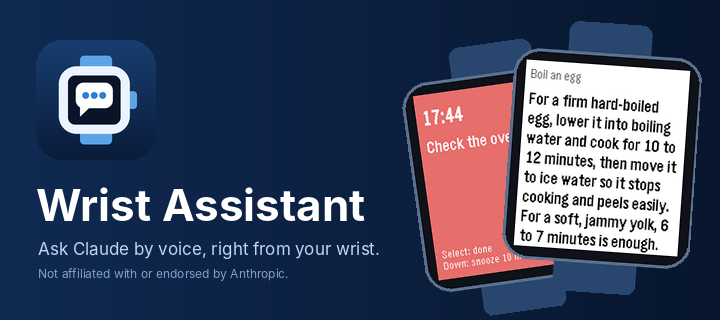
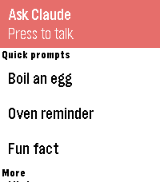

<p align="center"></p>

# Wrist Assistant

Ask Claude a question by voice from your Pebble watch and read a short answer on your wrist.

<p align="center"></p>

> **Not affiliated with or endorsed by Anthropic.** Wrist Assistant is an independent, open-source
> project that works with Claude through Anthropic's public API. "Claude" and "Anthropic" belong to Anthropic.

Two parts:

- **Watch app** (`wrist-claude/`, C + PebbleKit JS): published on the Pebble app store. Works on its own.
- **Android companion** (`wrist-claude-android/`, Kotlin): optional, sideloaded APK that adds phone actions.

## Features

**Watch app alone**
- Voice questions: press Select, speak, read a short answer
- Follow-ups in the same conversation; hold Select for a new question
- Quick prompts: one-press questions you set on your phone
- Reminders ("remind me in 20 minutes to check the oven") that buzz even when the app is closed
- History of your last 5 answers, readable offline
- Optional web search for current info (weather, scores, news)
- Choice of model (Haiku, Sonnet, Opus), answer length, units

**With the Android companion**
- Your API key lives on the phone and the companion calls Claude
- Draft texts and emails (opened pre-filled in your own apps), set alarms and timers
- Check and add calendar events
- Read and reply to recent notifications
- Read an answer aloud on the phone
- Save notes and hand off a whole conversation to a Google Doc in your own Drive
- Anything sent to another person is confirmed on the watch first

Details: [`wrist-claude/README.md`](wrist-claude/README.md).

## Requirements

- A Pebble or Core Devices watch (Pebble Time 2, Round 2, Pebble 2 Duo, Pebble Time, Time Round, Pebble 2)
  and the Pebble phone app
- **Your own Anthropic API key** from [console.anthropic.com](https://console.anthropic.com). Usage is
  billed to your Anthropic account.
- Optional, for the companion: an Android 10+ phone

## Install

1. **Watch app:** install Wrist Assistant from the Pebble app store
   (link: *coming soon, see* [`wrist-claude/store/listing.md`](wrist-claude/store/listing.md)).
   You can also sideload the `.pbw` from [Releases](https://github.com/MrArron/Wrist-Assistant/releases).
2. **Companion (optional):** download `wrist-assistant-companion-*.apk` from
   [Releases](https://github.com/MrArron/Wrist-Assistant/releases) and install it (allow installs from your
   browser or file manager when Android asks). It is not on the Play Store.

## Setup

1. Create an API key at console.anthropic.com.
2. Open Wrist Assistant's settings in the Pebble app, paste the key and press Save.
   (With the companion installed, enter the key in the companion instead; the Setup tab lists the
   permissions it needs.)
3. Optional, notes in Google Docs: in the companion's Notes tab tap **Connect** and sign in with Google.
   The app creates its own docs, "Wrist Assistant Notes" and "Wrist Assistant Context", in your Drive.
   You do **not** need a Google Cloud project; that is only for people building their own fork.

## Privacy

- Your API key stays on your phone and is sent only to `api.anthropic.com`.
- Your questions go only to Anthropic's API. There is no other server and no analytics.
- Notes documents live in your own Google Drive. The companion asks only for the `drive.file` scope,
  so it can open only files it created itself.
- Notification text is read only when you ask, and sending anything to another person needs your
  approval on the watch.

## Optional: use with your main Claude

If you also use Claude in claude.ai or the Claude app, it can work through your watch notes ("catch up on
my notes") and keep a short context doc up to date. Setup is in
[`for-claude/README.md`](for-claude/README.md). It has two pieces:

- a **"catch up on my notes" skill** that works through the notes and handoffs you saved from the watch;
- a **context refresh scheduled task** that keeps the "Wrist Assistant Context" doc current.

## Build from source

Watch app (Pebble SDK 4.33.1):
```
uv tool install pebble-tool && pebble sdk install 4.33.1
cd wrist-claude
pebble build
python3 tools/watch_size.py --platform emery
for f in test/pkjs/*.test.js; do node $f; done
```

Companion (JDK 21, Android SDK platform `android-37.2`, build-tools `37.0.0`):
```
cd wrist-claude-android
echo "sdk.dir=$ANDROID_HOME" > local.properties
./gradlew testDebugUnitTest lintDebug assembleDebug
```
A release build reads `wrist-claude-android/keystore.properties` (`storeFile`, `storePassword`, `keyAlias`,
`keyPassword`) and the `.jks` it names. Neither is in git; without them `assembleRelease` makes an unsigned
APK. If you fork and want Google sign-in, you need your own Google Cloud project and Android OAuth client
for your own package name and SHA-1: see "Building your own fork" in
[`wrist-claude/README.md`](wrist-claude/README.md). Release process: [`docs/RELEASING.md`](docs/RELEASING.md).

CI for the Android build is new; if it fails, see the workflow log.

## Project layout

```
wrist-claude/          Pebble watch app: src/c (watch), src/pkjs (phone JS), test/pkjs, docs/, store/
wrist-claude-android/  Android companion (Kotlin, Compose)
docs/                  RELEASING.md, development/ (build history and handoff notes)
.github/               CI, release workflow, issue and PR templates
.claude/agents/        Helper agents for contributors using Claude Code
```
Design docs: [`protocol.md`](wrist-claude/docs/protocol.md) (watch/phone protocol) and
[`companion.md`](wrist-claude/docs/companion.md) (companion, notes, context).

## Contributing, security, license

- [CONTRIBUTING.md](CONTRIBUTING.md)
- [SECURITY.md](SECURITY.md): report vulnerabilities privately
- [LICENSE](LICENSE): MIT
